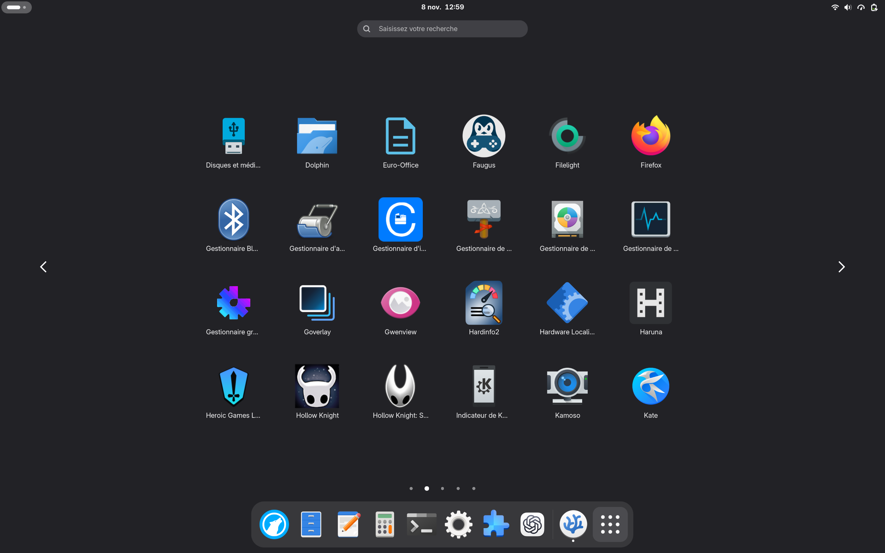
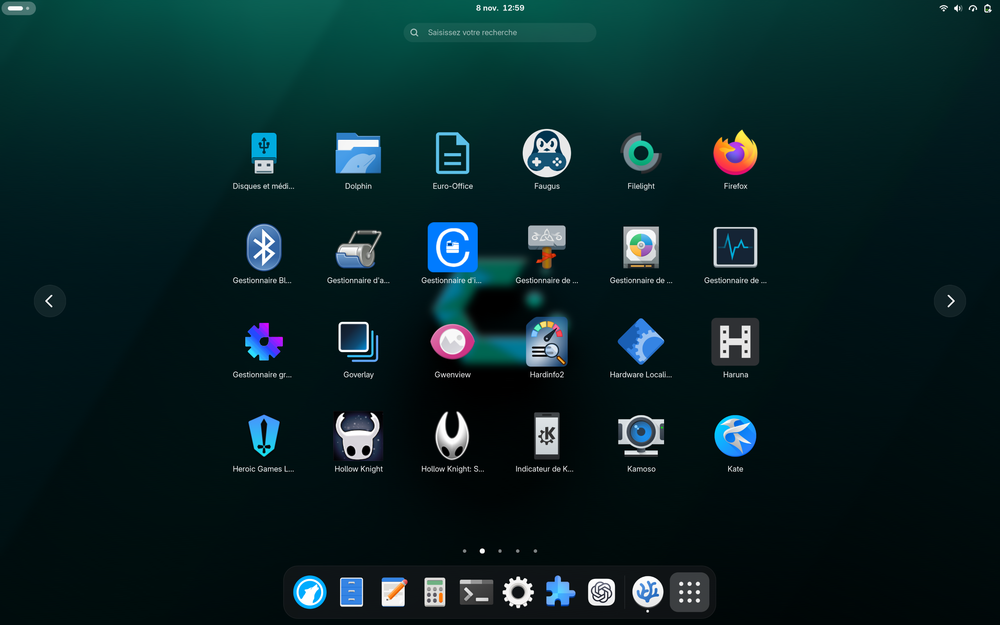

# Welcome to App Grid Only




**A cleaner way to browse your applications.**

App Grid Only is a GNOME Shell extension that opens the application grid directly when you press the Super key — without showing the usual workspace previews or window overview.

Inspired by the app launcher experience of macOS, it gives you a simple, distraction-free view of all your applications while keeping GNOME's native app grid, search, animations and launching experience.

## Features

- **Instant access:** Press Super to open your application grid directly.
- **No workspace previews:** No windows, thumbnails or workspace overview getting in the way.
- **Native GNOME experience:** Keeps the original application icons, layout, pagination, search and animations.
- **Simple navigation:** Press Super again or Escape to close the grid.
- **Keyboard search:** Just start typing to find an application.

## Installation

### Requirements

- GNOME Shell 51
- `gnome-extensions`
- `gjs`
- `python3`
- a POSIX-compatible `/bin/sh`

### From source

```bash
git clone https://github.com/Fkj94/app-grid-only.git
cd app-grid-only
./install.sh
```

The script checks the declared GNOME Shell major version, validates JavaScript
module syntax with Node.js or GJS, validates the generated bundle, and installs
it for the current user. In an active GNOME X11 or Wayland session it also
attempts to enable the extension. Outside such a session, it installs the files
and skips activation. Installation and activation do not constitute a functional
test.

## Recommended companion: Blur my Shell

We **highly recommend** using [Blur my Shell](https://extensions.gnome.org/extension/3193/blur-my-shell/) alongside App Grid Only.

It adds a beautiful blur effect to the overview background, creating an even more polished, Launchpad-like experience.

Blur my Shell is optional and is not included with App Grid Only.



## Compatibility

- GNOME Shell 51
- Wayland

Compatibility with other GNOME Shell versions and configurations is not guaranteed yet.
